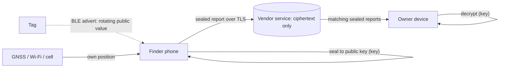
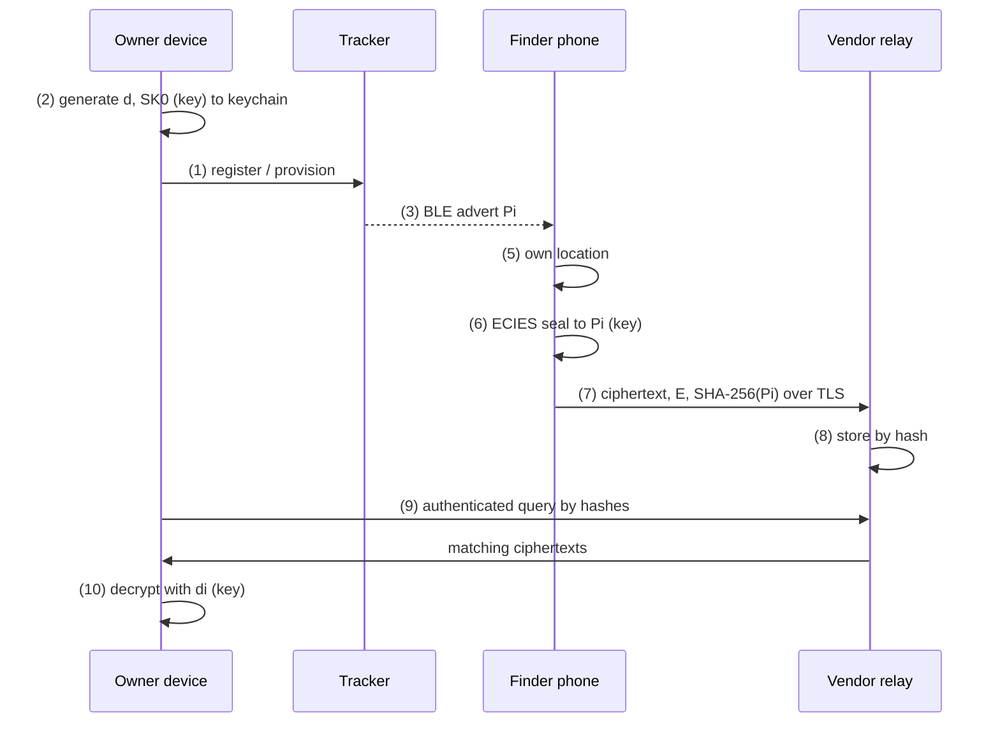

# From Tap to Trace — editorial notes and diagram specifications

The article: `articles/from-tap-to-trace.html` (published 2026-10-22, category
`technology`). Hand-written HTML, self-contained CSS, no build step of its own.
This file holds what does not belong on the page: title options, the rules the
page follows, how to add the sixteen illustrations, and the full specification
for each one.

## 1. Titles

1. **From Tap to Trace: NFC, AirTags, Cloud Identity, and the Quantum Future of Human Privacy** (the brief's title)
2. The Invisible Map: How a Keychain Joined a Planet-Sized Network
3. Who Owns the Signal? Trackers, Keys, Accounts and the People They Follow
4. Encrypted Is Not Consented: The Hidden Architecture of Item Trackers
5. Find the Object, Not the Person

**Recommended: 1**, with "The Invisible Map" as the kicker (as shipped). It
names all three layers (radio, identity, cryptography) and the time horizon;
"Tap" and "Trace" carry the NFC-to-tracking distinction the piece insists on.
Title 4 is the strongest LinkedIn hook if a shorter share line is needed.

## 2. Rules the page follows (keep them on every edit)

- **Evidence labels** on important claims: Documented · Vendor claim · Research ·
  Historical · Open · Inference · Speculative (legend at the top of the page).
  Never upgrade a label without a primary source.
- **Never turn a historical finding into a present-tense vulnerability.** Patch
  status is stated, or the finding is labelled Historical/Open.
- **No operational stalking detail**: no concealment, alert-evasion or account
  intrusion steps, ever. Mechanisms are described only as far as a defender
  needs to recognise them.
- **Safety first**: Part XI and every safety note say that disabling a tracker or
  changing sharing can alert an abuser. Keep that.
- **Generations and vendors differ**: never assert one vendor's curve, rotation
  period or key custody for another, or for the 2026 AirTag, without a source.
- **Quantum**: theoretical vulnerability vs demonstrated attack, always. Nothing
  says reports are being decrypted today.
- **References are numbered automatically**: write
  `<sup class="ref"><a href="#r-id">[?]</a></sup>` and renumber with the snippet
  in §5. Every `r-*` id in the list must be cited at least once.
- The **accuracy audit** (`#audit`) lists everything unverified. Update it when a
  claim is checked or changes.

## 3. Adding the illustrations

**Status (2026-10-22):** Paddy supplied five diagrams (SVG + PNG, 1900×1000),
now in `images/articles/from-tap-to-trace/` and wired in:

| Figure | File | Paddy's title |
| --- | --- | --- |
| 01 | `fig-01-network.svg/.png` | How an AirTag is found without GPS or cellular |
| 02 | `fig-02-nfc-ble-uwb.svg/.png` | NFC, BLE, and UWB do different jobs |
| 03 | `fig-03-account-keys.svg/.png` | An Apple Account is not a decryption key |
| 06 | `fig-06-find-my-keys.webp` | Public keys, rotating IDs, and privacy in Find My (2nd upload) |
| 10 | `fig-10-unwanted-tracking.svg/.png` | Why encryption does not prevent unwanted tracking |
| 14 | `fig-14-quantum.svg/.png` | Quantum risk is not one universal attack on encryption |

The page shows the SVG (crisp, ~12 KB) and links to the PNG ("Open full size").
The "diagram in words" stays below each image in a `<details class="fig-words">`.
Figures 04, 05, 07–09, 11–13, 15 and 16 still render as text only; a new image for one
of them follows the same pattern (`.fig-img` then `.fig-words`).

Each of the five was checked against the article: none shows plaintext at the
service, none implies NFC tracks, and the quantum figure says current AirTags are
not assumed to use ML-KEM.

### How to add one

Each figure has a slot: `<figure class="fig" id="fig-NN">` with a comment naming
the expected file. Today each slot shows a **diagram in words** (the `.flow` or
`.lanes` block inside `.fig-art`), so the page is complete without images.

1. Save as `images/articles/from-tap-to-trace/fig-NN-<name>.svg` (and a PNG).
2. Before the figure's `.fig-art`, add
   `<div class="fig-img"><a href="….png"></a><a class="fig-full" href="….png">Open full size ↗</a></div>`.
3. Wrap the existing `.fig-art` in
   `<details class="fig-words"><summary>Diagram in words</summary> … </details>`
   and drop its `role="img"`/`aria-label` (the `` replaces it).
4. Check the image against the figure's **must-not** list below before publishing.
   If an image implies something false, fix the image, not the caption.
5. Run `python3 scripts/platform_build/build.py all` and the article's accessibility
   check (axe, desktop and 390 px).

## 4. Diagram specifications

Shared design language: midnight navy `#0d1a33`, warm ivory `#f7f2e8`, graphite
`#2a2f37`, subdued cyan `#3f8f9e` (on dark) / `#2a6773` (on light), electric blue
`#2257d6`, amber `#f0c56b` (key material, on dark), restrained red `#a3241b` only
for real risk states. Inter for labels, Fraunces for headlines, JetBrains Mono for
technical tags. Minimum label size 14 px at 1600 px wide. No glowing clouds,
no padlock ornaments, no circuit-board backgrounds, no stock photos, no generic
"hacker" figures.

**Arrow semantics (all figures):** solid = data flow; double-line = authorisation
or key relationship; dashed = monitoring / governance / conceptual association;
dotted cyan = radio broadcast; amber key glyph only where key material is used.
Every arrow has a direction and a label.

**Status badge (all figures):** each figure carries a small badge: DOCUMENTED,
CONCEPTUAL, or PROPOSED (future state), matching the `.fig-kind` text on the page.

---

### Fig 01 — A Tiny Tag. A Planet-Sized Network.
- **Takeaway:** A tag does not need its own internet connection to take part in a global finding network.
- **Status:** Documented flow (Apple Find My), conceptual geography.
- **Prompt (16:9):** Isometric, layered cutaway of a city block at dusk in midnight navy and ivory. Centre: a coin-sized tracker inside an open suitcase on an airport baggage cart. Dotted cyan arcs (Bluetooth LE) reach three nearby smartphones held by passers-by; only one is highlighted. From that phone, a thin solid ivory line rises through a translucent layer labelled "Internet (TLS)" to a restrained, rectangular server block labelled "Vendor service: stores sealed reports" (no glow, no cloud icon). A second solid line descends from the service to a separate phone at an arrivals hall, labelled "Owner's authorised device"; a small amber key glyph appears only at that phone and at the sealing step on the finder phone. Four paths are visually distinct: radio, local positioning (a satellite and Wi-Fi glyph feeding the finder phone), internet transport, authorised decryption. Precise, editorial, Apple-keynote minimalism.
- **Prompt (4:5):** Same elements stacked vertically: tag at bottom, finder phone, internet layer, service, owner phone at top.
- **Nodes:** Tag · Finder phone (stranger) · GNSS/Wi-Fi/cell (positioning sources) · Internet/TLS layer · Vendor service · Owner device.
- **Edges:** Tag → Finder "BLE advert: rotating public value" (dotted cyan) · Positioning → Finder "own position" (solid thin) · Finder → Finder "seal to public key" (amber key) · Finder → Service "sealed report over TLS" (solid) · Service → Owner "matching sealed reports" (solid) · Owner → Owner "decrypt" (amber key).
- **Must not:** show plaintext location at the service; draw a GPS receiver in the tag; draw the tag connecting to the internet; imply a guaranteed delay.
- **Mermaid:**


### Fig 02 — Not Every Wireless Signal Is a Tracking Signal.
- **Takeaway:** NFC, BLE, UWB and GPS must not be treated as interchangeable.
- **Status:** Engineering characteristics; ranges indicative.
- **Prompt (16:9):** A scientific comparison plate. Left: a horizontal log-frequency axis with six labelled bands (125 kHz LF RFID, 13.56 MHz NFC/HF RFID, ~900 MHz UHF RFID, 1.2–1.6 GHz GNSS, 2.4 GHz BLE/Wi-Fi, 6–9 GHz UWB). Right: four columns headed "What is it? · Is it near? · How far, which way? · Where on Earth?" with filled or hollow circles per technology. Below: a log-distance scale from 1 cm to "global", each technology shown as a fading gradient bar labelled "typical", never a hard-edged circle. Bottom strip: an AirTag silhouette with three internal component chips (BLE, UWB, NFC) and three struck-through ghost chips (GNSS, Cellular, Wi-Fi).
- **Nodes:** RFID (LF/HF/UHF/active) · NFC · BLE · UWB · GNSS · Wi-Fi/cellular positioning · AirTag component strip.
- **Edges:** none (matrix figure); conceptual association lines only from each tech to the question(s) it answers.
- **Must not:** draw fixed range circles; imply NFC tracks; give the AirTag GNSS; confuse manufacturer features (Precision Finding) with physics (keep them in a labelled overlay).

### Fig 03 — The Tracker Is Registered to an Identity, Not Simply Married to a Phone.
- **Takeaway:** Account binding, cryptographic authorisation and physical device possession are distinct.
- **Status:** Apple: documented layers; sharing-recipient key path not documented.
- **Prompt (16:9):** Five horizontal translucent planes stacked like an exploded architectural model, each a different tint: (1) Account (Apple Account, password + two-factor, tag registration), (2) Device enrolment (iPhone, iPad, Mac as trusted; one dim "old iPhone in a drawer" with an amber question mark), (3) Key access (an end-to-end keychain ring linking the trusted devices; the vendor server outside the ring with "no private key"), (4) Tag hardware (serial number for accountability; rotating broadcast keys for radio), (5) Sharing (up to five invited people; note "their alerts for this tag: suppressed"). Vertical connectors only where a real relationship exists.
- **Edges:** Account → Tag "registered to" (double line) · Trusted devices ↔ Keychain "member of (device/passcode gated)" (double) · Keychain → Devices "tag keys, end-to-end" (amber key) · Owner → Sharing recipient "authorised by owner" (double, dashed outline: key path undocumented) · Vendor → Keychain "relays ciphertext" (solid thin).
- **Must not:** draw the password unlocking the keychain; draw the vendor holding private keys; draw sharing as a specific cryptographic operation.

### Fig 04 — The Lock Everyone Can See. The Key Not Everyone Can Use.
- **Takeaway:** A public key is not a password and does not decrypt what was locked to it.
- **Status:** General cryptography.
- **Prompt (16:9):** Two clean panels. Left: many identical open padlocks (public key) handed to strangers; one stranger locks a box. Right: only the recipient's private key opens it. Below, an engineer strip with three rows: Public-key encryption (anyone → recipient), Digital signature (signer → anyone verifies), Symmetric session (one shared key, AES-GCM). A fourth row of struck-through false claims: "public key decrypts", "public key reveals private key", "encryption proves sender".
- **Edges:** Public key → Ciphertext "encrypt" · Private key → Plaintext "decrypt" · Private key → Signature "sign" · Public key → Valid/invalid "verify".
- **Must not:** use ornamental padlocks elsewhere in the series; imply encryption authenticates the sender.

### Fig 05 — Birth, Pairing, Ownership, Sharing, Revocation.
- **Takeaway:** A tag's security is decided at its transitions.
- **Status:** Conceptual lifecycle; Apple-documented transitions marked.
- **Prompt (16:9):** Horizontal timeline with eight stages (Manufacture, Setup, Registration, Authorised use, Sharing, Recovery, Transfer, End of life) and four swimlanes beneath (Hardware state, Account state, Cryptographic material, Permissions). Security transitions marked with a thin amber bracket; "must reject: re-pairing by a non-owner" shown as a red stop marker at Registration and Transfer.
- **Must not:** show a factory reset releasing the pairing lock; draw keys at Manufacture for an owner.

### Fig 06 — Follow the Signal, Follow the Trust Boundaries.
- **Takeaway:** The cloud stores sealed envelopes it cannot open; nothing checks the coordinates are true.
- **Status:** Apple Find My, documented sequence.
- **Prompt (16:9, large format):** A sequence diagram with five swimlanes (Tracker, Finder phone, Vendor relay, Owner device, Shared recipient) and numbered arrows ①–⑩ exactly as on the page. Distinct semantics: dotted cyan for BLE broadcast, small local loop for own-position, amber key at ② generate, ⑥ seal, ⑩ decrypt only, solid ivory for TLS upload/download, double line for authenticated account query. Three trust-boundary lines labelled: finder→service (TLS), owner→service (account session), owner devices↔keychain (end-to-end).
- **Second layer (engineers):** overlay labels `SKᵢ = KDF(SKᵢ₋₁,"update")`, `Pᵢ = uᵢ·P + vᵢ·G`, `S = e·Pᵢ`, `X9.63-KDF-SHA256`, `AES-GCM`, `index = SHA-256(Pᵢ)`.
- **Must not:** put a key at the vendor relay; show plaintext at the relay; draw the shared recipient's decryption as a documented key operation.
- **Mermaid:**


### Fig 07 — One Device, Many Temporary Faces.
- **Takeaway:** Rotation hides what a tag says, not that something is there.
- **Status:** Conceptual; periods vary by state, generation and vendor.
- **Prompt (16:9):** One tag drawn once on the left; to its right a timeline of masks/badges P₁…Pₙ in subtly different hues. Beneath, a translucent observer band with thin dashed lines attempting to join consecutive badges, annotated with side-channel labels: "same place", "same time", "same signal", "same direction", "RF fingerprint", "long window when separated". Above, an owner band computing every Pᵢ from a secret (amber key).
- **Must not:** print a universal rotation period; depict a working linkage method step by step.

### Fig 08 — One Tap. Two Very Different Security Outcomes.
- **Takeaway:** Short radio range does not by itself guarantee safe authorisation.
- **Status:** General NFC architecture.
- **Prompt (16:9):** Two parallel flows from a single hand tapping. Left (cyan): phone wallet secure element → reader challenge → cryptogram → issuer/access server verifies → door/payment. Right (red, restrained): sticker over a legitimate tag → NDEF URL → browser → fake login page; defence callout "preview the URL; never sign in from a tap". Inset (bottom, boxed, clearly separate): relay chain — victim card ↔ mole reader ↔ long link ↔ proxy card ↔ door reader; defences "timing bounds · user presence · secure ranging".
- **Must not:** connect any part of this figure to Bluetooth trackers.

### Fig 09 — The Hidden Complexity of Digital Ownership.
- **Takeaway:** Every path to a location has its own off switch; revocation is forward-only.
- **Status:** Conceptual states.
- **Prompt (16:9):** Three side-by-side state panels (Normal, Unauthorised, Revoked), each with the same five gates: Password, Trusted devices, Key availability, Sharing, Recovery. Valid paths drawn solid green-grey; paths that remain open in the Unauthorised panel drawn red; in Revoked, closed gates shown shut, plus a greyed "past observations: cannot be recalled".
- **Must not:** show the password alone opening key availability.

### Fig 10 — An Object Tracker Can Become a Human Movement Proxy.
- **Takeaway:** The tag is an object; the trail is a person.
- **Status:** Conceptual; no timing guarantees.
- **Prompt (4:5 primary, 16:9 secondary):** Two synchronised vertical timelines. Left: a person's day as quiet icons (home, commute, workplace, clinic, a family member's house, home). Right: the tag owner's map dots appearing intermittently, with gaps. A thin third column for the person's phone with "possible alert" markers and question marks, no clock times on alerts.
- **Must not:** show where or how a tag was hidden; draw an alert at a specific elapsed time.

### Fig 11 — To Protect the Owner, Hide the Identity. To Protect the Victim, Recognise the Tracker.
- **Takeaway:** Every anti-stalking design picks a point in a trade-off space.
- **Status:** Conceptual trade-off.
- **Prompt (16:9):** An elegant triangle: vertices Owner privacy, Third-party unlinkability, Victim detectability. Sliders on the edges: rotation period, separated-state flag, sound on movement, aggregation threshold. Inside, three labelled attempts: cross-platform specification (DULT), research on linkable-only-with-sustained-co-travel designs, manual scans.
- **Must not:** title or label it an impossibility; present DULT as a guarantee.

### Fig 12 — Apple, Google, Samsung, and Tile: Similar Goals, Different Architectures.
- **Takeaway:** Alike from a distance; different in key custody, operator visibility and evidence.
- **Status:** Evidence-labelled.
- **Prompt (16:9):** Four aligned architecture miniatures in columns, identical lanes (Tracker, Finder network, Cloud, Account, Keys, Alerts, Owner device). Chips coloured by evidence: green documented, amber vendor-only/undisclosed, red research finding against the property. Each chip has a tiny source tag.
- **Must not:** draw protocol arrows between ecosystems (alerts interoperate by specification; finding does not); fill an undisclosed cell with an assumption.

### Fig 13 — Where Can an Invisible Ecosystem Be Abused?
- **Takeaway:** The worst, most feasible abuses need no exploit.
- **Status:** Threat model; ratings illustrative.
- **Prompt (16:9 poster):** A representative ecosystem at centre (tag, finder, service, account, key store, owner device, person) surrounded by six regions (Physical, Wireless, Cryptographic, Account, Cloud, Human/social). Numbered threat markers (1–17, matching the catalogue) connect to the exact component they act on. Inset: a 3×3 severity × feasibility grid labelled "illustrative".
- **Must not:** use a single attacker icon pointing at everything; merge radio, account, data and physical categories.

### Fig 14 — What Quantum Changes — and What It Does Not.
- **Takeaway:** Theoretical threat to public keys, modest effect on symmetric, nothing broken in practice.
- **Status:** Theoretical vulnerability; no demonstrated attack.
- **Prompt (16:9):** Three vertical columns: Classical public key (ECDH/ECIES, ECDSA/EdDSA, RSA), Symmetric & hash (AES-256, AES-128, SHA-256/SHA-3), NIST post-quantum (ML-KEM FIPS 203, ML-DSA FIPS 204, SLH-DSA FIPS 205, HQC selected). A bold arrow "Shor — if a cryptographically relevant quantum computer exists" into each public-key item separately; a thin arrow "Grover — idealised, quadratic" into symmetric. Bottom: system components (BLE broadcast key, report encryption, TLS, firmware signing, account sign-in, NFC credentials) each connected to the algorithm it typically uses.
- **Must not:** draw a quantum computer decrypting AirTag reports; assume one algorithm for the whole system.

### Fig 15 — Crypto-Agility: Securing Devices That May Outlive Their Cryptography.
- **Takeaway:** The hard part is everything around the algorithm.
- **Status:** PROPOSED future state (only hybrid TLS on current Apple platforms and the NIST algorithms are documented).
- **Prompt (16:9):** Layered stack from bottom: Tag hardware, Secure provisioning, Mobile software, Cloud APIs, Crypto services, Identity governance. Right side: a circular lifecycle Assess → Design → Pilot → Migrate → Validate. Future-state components drawn with dashed outlines; documented components solid. Callouts: "legacy tags cannot upgrade: retire on schedule", "multiple trust anchors in bootloader", "dual-signed releases", "versioned report formats".

### Fig 16 — Governing an Endpoint You May Not Own, See, or Manage.
- **Takeaway:** The enterprise's leverage is over its own assets, accounts, processes and people.
- **Status:** Programme architecture, proposed.
- **Prompt (16:9 poster):** Seven horizontal layers (Human safety & privacy; Physical & assets; Wireless & endpoint; Identity & accounts; Encryption & data; Vendor & lifecycle; Incident & legal). Trust-zone boundaries: Enterprise, Vendor ecosystems (outside), Personal. Solid arrows only for implemented flows (e.g., company tags → managed accounts); dashed arrows for governance (procurement requirements, legal requests) into the vendor zone. A 30/90/180-day ribbon along the bottom.
- **Must not:** draw the enterprise controlling or monitoring consumer networks; draw unlabelled arrows.

## 5. Renumbering references

```sh
python3 - <<'PY'
import re
p='articles/from-tap-to-trace.html'
s=open(p,encoding='utf-8').read()
ids=re.findall(r'<li id="(r-[a-z0-9]+)"',s)
num={k:i+1 for i,k in enumerate(ids)}
s=re.sub(r'href="#(r-[a-z0-9]+)">\[[^\]]*\]',lambda m:f'href="#{m.group(1)}">[{num[m.group(1)]}]',s)
used=set(re.findall(r'href="#(r-[a-z0-9]+)">\[',s))
print("unused:",set(ids)-used)
open(p,'w',encoding='utf-8').write(s)
PY
```

## 6. Research notes (2026-10-22)

The research container could not fetch apple.com, support.apple.com or arxiv.org
directly (egress policy). Those sources were verified through search listings,
localised copies and press; the article's audit says so. Before the next edit,
re-read: Apple Find My security; the January 2026 AirTag newsroom post;
arXiv:2604.10138; the DULT datatracker page (RFC status); Samsung and Life360
statements on the 2024 and 2025 findings.
